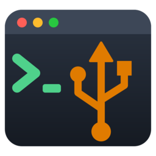

# <h1 align="center"><br>WSL USB Manager</h1>

## Table of contents

- [What's this?](#whats-this)
- [Supported devices](#supported-devices)
- [Installation](#installation)
- [How to use](#how-to-use)
- [Troubleshooting](#troubleshooting)
- [Copyright and license](#copyright-and-license)


What's this?
============

## About

WSL USB Manager is a small Windows app (WPF, .NET 8) that lists your USB devices, recognizes USB drives,
microcontrollers and FPGA programmers, and shares them with WSL2 through
[usbipd-win](https://github.com/dorssel/usbipd-win) with one click.
It also runs `arduino-cli` inside WSL, so you can compile and upload sketches from the same window.

## Why

usbipd-win is fantastic marvelous wonderful, instead of typing `usbipd list`, `usbipd bind --busid 3-2` and
`usbipd attach --wsl --busid 3-2` every time you plug in a board is shitty and gets old very fast,
especially when the bus id changes, WSL goes idle and drops the device, or the board
resets into a bootloader with a different VID:PID.

This app does all of that for you:

- Shows which device is an Arduino, ESP32, STM32, RP2040/RP2350, FPGA programmer or plain serial bridge.
- Binds (asks for admin only once) and attaches devices to WSL with one click.
- Remembers favorites and re-attaches them automatically when they are plugged in.
- Uploads to RP2040/RP2350 and STM32 Nucleo boards through the drive Windows mounts, then hands the board back to WSL.

## Supported devices

The **Show** checkboxes filter the list by family:

| Family | Recognized devices |
|---|---|
| **Arduino** | Uno, Mega 2560, Leonardo, Micro, Nano Every, Uno R4 Minima/WiFi, SparkFun Pro Micro, Adafruit, Seeed, Teensy |
| **ESP32** | ESP32 / S2 / S3 / C3 / C5 / C6 / H2 / P4 native USB, Arduino Nano ESP32, bridges whose product string says ESP32 |
| **STM32** | ST-LINK/V1, V2, V2-1, V3, V3PWR, STM32 DFU bootloader, STM32 Virtual COM, Blue Pill (Maple) |
| **RP2040 / RP2350** | Pico, Pico 2, BOOTSEL mode, MicroPython, Debug Probe, Nano RP2040 Connect |
| **FPGA** | Altera USB-Blaster, Intel USB-Blaster II (DE10-Nano, DE10-Standard...), **Arrow USB Blaster (Arrow MAX1000, Arrow/Trenz CYC1000, DECA)**, Arduino MKR Vidor 4000, Xilinx Platform Cable USB II, Digilent (Arty, Basys, Nexys, Cmod, Zybo, Adept cables), Lattice cables & iCEstick, iCEBreaker, UPduino, TinyFPGA BX, Fomu, pico-ice, ULX3S, OrangeCrab, ButterStick, Sipeed Tang Nano/Primer/Mega (Gowin), Alchitry, Efinix Trion, Microchip FlashPro |
| **Serial bridges** | CH340/CH341/CH343/CH9102, CP210x, FTDI FT232R/FT2232/FT4232/FT232H/FT231X, PL2303 |
| **Other** | Everything else (keyboards, hubs, cameras...) |

> A bridge chip with a generic name (e.g. an FT2232 saying only "Dual RS232-HS") can't tell what is
> behind it over USB, so it is shown as *Serial bridge*. FTDI-based FPGA blasters are recognized by
> their USB product string ("Arrow USB Blaster", "CYC1000", "Digilent USB Device"...).

# Installation

## Requirements

| What | Where | Needed for |
|---|---|---|
| Windows 10 2004+ / Windows 11 (x64) | Windows | everything |
| WSL2 + a distro | Windows | running |
| usbipd-win ≥ 4.0 | Windows | running (`winget install --exact --id dorssel.usbipd-win`) |
| arduino-cli | inside WSL, reachable from `bash -lc` | Arduino panel (optional) |

No .NET runtime is needed: the exe is self-contained.

## Installer (recommended)

1. Download `WslUsbManager-<version>-setup-x64.exe` from the [Releases](../../releases/latest) page.
2. Run it. You can install for all users (needs admin) or only for you (no admin).
3. If usbipd-win is missing, the installer tells you how to get it.

There is also a `WslUsbManager-<version>-portable-x64.zip` with the single exe if you don't want to install anything.

## Build from source

You need the .NET 8 SDK.

```powershell
dotnet build WslUsbManager.sln
dotnet run --project WslUsbManager
dotnet publish WslUsbManager/WslUsbManager.csproj -c Release -o publish
```

The publish command produces a self-contained single file at `publish/WslUsbManager.exe`.
In VS Code, press **F5** to debug (C# Dev Kit), or use **Terminal → Run Task → publish (single-file exe)**.

# How to use

## Share a device with WSL

1. Pick the target WSL distro.
2. Use the **Show** checkboxes to hide what you don't care about (hubs, keyboards...).
3. Select a device and click **Attach**.
   - If the device isn't shared yet, it is bound first. Windows asks for administrator approval once (only *bind*/*unbind* need it).
   - All WSL2 distros share one kernel, so an attached device is visible in every running distro.
4. Click **☆** to make a device a favorite and tick **Auto** to attach it automatically whenever it is plugged in.
   - A manual *Detach* pauses auto-attach for that device until it is unplugged.

## Arduino panel

1. **Detect boards** finds `/dev/ttyACM*` / `/dev/ttyUSB*` and the FQBN.
2. Choose the sketch folder and click **Compile & Upload**.
3. **Serial Monitor** opens a console window.

## RP2040 / RP2350 and STM32

1. Choose the core in **Core** and click **Install / update**. This adds the board-manager URL and installs `rp2040:rp2040` or `STMicroelectronics:stm32` inside WSL.
2. Pick an FQBN, e.g. `rp2040:rp2040:rpipico2` or `STMicroelectronics:stm32:Nucleo_64:pnum=NUCLEO_F411RE`. The FQBN is pre-filled when you select a recognized board.
3. Leave **Upload** on *Auto* and click **Compile & Upload**:

| Board | What happens |
|---|---|
| **RP2040/RP2350** | The app compiles in WSL and resets the board to BOOTSEL. It copies the `.uf2` to the drive Windows mounts, then re-attaches the board to WSL. On a first upload, or if the board doesn't reset, hold BOOTSEL while plugging it in. |
| **STM32 Nucleo/Discovery** | The app compiles in WSL and temporarily detaches the ST-LINK. It copies the `.bin` to the NOD_xxx drive, then re-attaches the ST-LINK. |
| **STM32 via SWD inside WSL** | Use `…,upload_method=OpenOCDSTLink` (the OpenOCD is bundled). Attach the ST-LINK and click **USB permissions** once; it asks for your sudo password in a console. |

## FPGA boards and programmers

1. Tick **FPGA** in **Show** and attach the blaster / board to WSL.
2. Program it from WSL with your usual tools, for example:
   - [openFPGALoader](https://github.com/trabucayre/openFPGALoader): `openFPGALoader -b cyc1000 top.rbf`, `openFPGALoader -c usb-blaster top.svf`, `openFPGALoader -b arty top.bit`, `openFPGALoader -b tangnano9k top.fs`...
   - Quartus Programmer for Linux (`quartus_pgm`, `jtagconfig`). The Arrow USB Blaster (MAX1000 / CYC1000 / DECA) needs the Arrow USB Blaster driver for Linux installed in Quartus.
3. Give your user access to the JTAG device: install the udev rules of your tool, or click **USB permissions**.
4. Want to use Quartus / Vivado on Windows instead? Just **Detach** the device: it goes back to Windows.

The MKR Vidor 4000 gets the `arduino:samd:mkrvidor4000` FQBN, so the Arduino panel works for its SAMD21 side.

## Files

- Settings: `%LocalAppData%\WslUsbManager\settings.ini` (favorites, last distro/port/FQBN, filters, `ArduinoCliPath`).
- Logs: `%LocalAppData%\WslUsbManager\logs\log-yyyyMMdd.txt`.

# Troubleshooting

- **`arduino-cli` not found**: symlink it with `sudo ln -s ~/path/arduino-cli /usr/local/bin/`, or set `ArduinoCliPath` in `settings.ini`.
- **`Permission denied` on `/dev/ttyACM0`**: run `sudo usermod -aG dialout $USER`, then `wsl --shutdown`.
- **Device disappears from WSL after a while**: WSL shuts down idle VMs, which detaches the device. Favorites with *Auto* are re-attached automatically.
- **USB-Blaster II / Xilinx Platform Cable shows up twice**: these load their firmware on first use and re-enumerate with a new PID (`09FB:6010` → `09FB:6810`, `03FD:000D` → `03FD:0008`). Attach the second one, or make both favorites with *Auto*.

### Copyright and license

Copyright (c) 2026 KabukiFlux. See [LICENSE](LICENSE) (MIT Licensing).

I'm not responsible
============
And yes, read below, no responsability taken on bad use.

DISCLAIMER (MIT Licensing)
==========================
Permission to use, copy, modify, and distribute this software for any
purpose with or without fee is hereby granted, provided that the above
copyright notice and this permission notice appear in all copies.

The software is provided "as is" and the author disclaims all warranties
with regard to this software including all implied warranties of
merchantability and fitness. In no event shall the author be liable for
any special, direct, indirect, or consequential damages or any damages
whatsoever resulting from loss of use, data or profits, whether in an
action of contract, negligence or other tortious action, arising out of
or in connection with the use or performance of this software.
